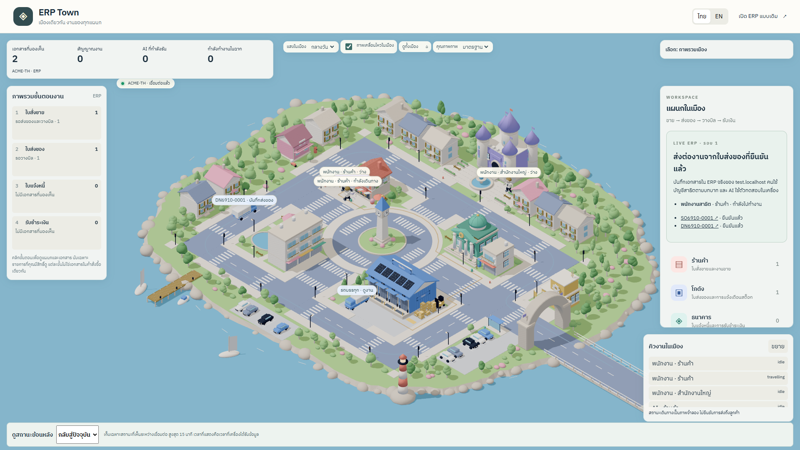
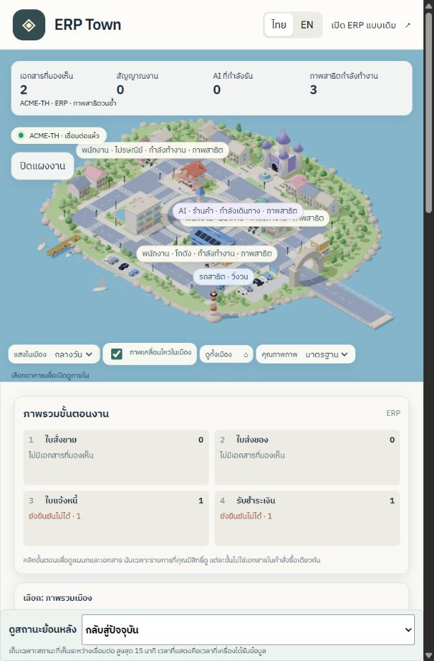
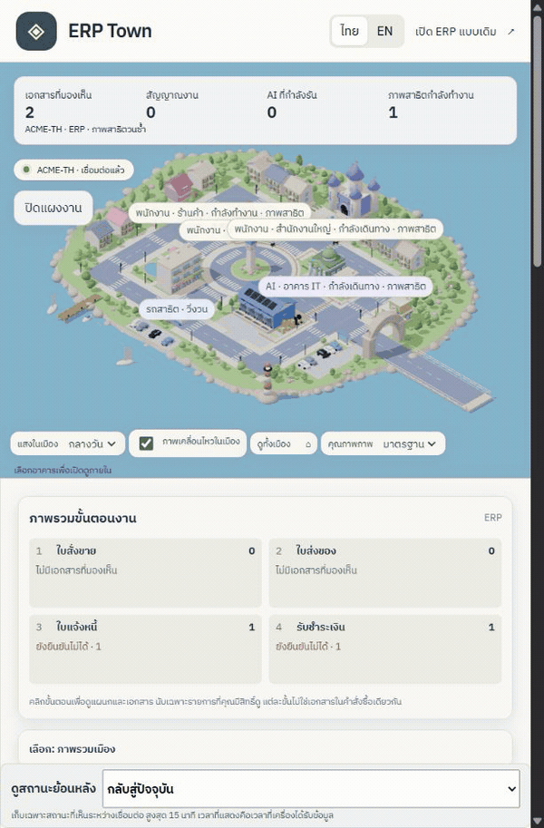
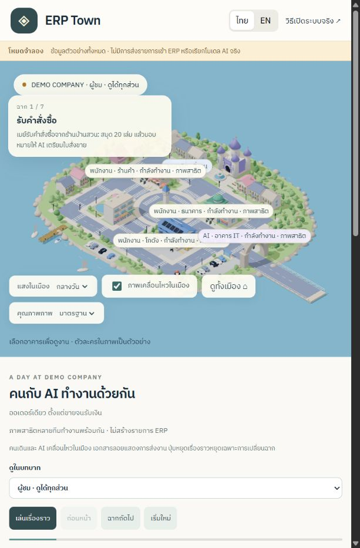
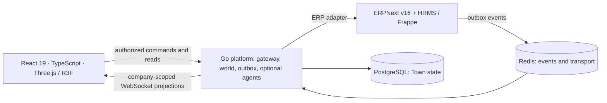

# ERP Town

**An ERP workspace presented as a 3D office-simulation game.** ERPNext v16 and
HRMS remain the business system of record; a Go platform turns authorized business
events into a shared town, and a React client makes work visible and actionable.
Thai and English are supported.

> Development preview, not a production release. Online showcase data is fictional.
> The full local demo creates actual documents only on `test.localhost` and restores
> that site's database when stopped. The AI demonstration uses a local test provider.







[Watch the MP4 recording](docs/media/live-town.mp4). These captures show the local
ERP-connected client after one completed business round. Movement loops are
presentation: they do not repeat orders, deliveries, invoices or payments.

## Try it

[**Play the online showcase on GitHub Pages**](https://atipongsena.github.io/erp-town/).
Select Observer to watch concurrent motion, or switch to AI/Manager/Warehouse/Accounts
to practice the sample handoffs. Use the town animation checkbox to pause motion.
The source repository is private; the online sample website is publicly viewable.



The online showcase and full local ERP demo have different capabilities:

| Experience | What you can do | Backend |
| --- | --- | --- |
| Online showcase | Explore six departments, switch illustrative roles, walk through order-to-payment handoffs, change lighting, pause motion, watch concurrent staff and a circulating truck | Browser-local sample data; no login, ERP writes or model calls |
| Full local demo | Inspect real submitted sales orders, delivery notes, invoices and payments; view the connected town, dashboard and Classic ERP | Docker ERPNext/HRMS, Go, Redis and PostgreSQL |
| Connected development workspace | Work with your actual local company's permissions, explicit document actions, world updates, avatars and session replay | Separately provisioned local gateway/world reader |

GitHub Pages hosts static HTML, CSS and JavaScript. It cannot run ERPNext, the Go
service or these databases. A remotely accessible full ERP deployment needs a
separate Docker-capable host and completion of the pilot acceptance work.

### Full stack local demo

Prerequisites: Node.js >=24, pnpm 10, Go 1.27, Docker Desktop, and gcc on PATH for
Go race tests (Windows: MSYS2 ucrt64). Chrome desktop with WebGL2 is recommended.

```sh
git clone https://github.com/atipongsena/erp-town.git
cd erp-town
pnpm install
pnpm erp:up
node scripts/live-demo.ts --rounds=1
```

The first ERP boot can take 15–30 minutes. The launcher prints its available local
URL; use that URL rather than assuming a port. It starts an isolated Go acceptance
host, seeds `test.localhost`, and runs a bounded order-to-payment scenario. Open the
document links or **Classic ERP** to inspect the actual records. The illustrated
staff and truck continue circulating after the business round completes.

Enter `stop` in the launcher's terminal to shut down and restore the test-site
database. Do not run other tests that seed/restore `test.localhost` concurrently.
Do not expose this local acceptance host or development credentials to the internet.

For a frontend-only preview:

```sh
pnpm dev:client
# Open the printed URL with ?mode=demo&lang=th
```

For the connected development workspace, follow
[local runtime operations](docs/local-runtime-operations.md) and
[world-state operations](docs/world-state-operations.md), then run
`node scripts/dev-workspace.ts --world`. Schema provisioning and a dedicated
read-only ERP credential must already be complete. Keep all credentials in local,
ignored environment files.

## What is implemented

- Six departments: sales shop, warehouse, bank/accounts, headquarters, IT and post.
- A shared dashboard over the 3D scene: authorized document counts, process queues,
  selected actors/vehicles/documents, camera following and a narrow-screen drawer.
- In-world workstation monitors render the same scoped dashboard with bounded,
  reusable textures.
- Human and AI task states, keyboard-accessible scene selection, day/sunset/night
  lighting, reduced motion, economy rendering and a no-WebGL fallback.
- Verified document journeys use real SO → DN → SI → PE references. Settlement is
  shown only when the actual invoice's outstanding amount is zero. Scene movement
  does not prove physical delivery or employee location.
- Authenticated ERP command boundaries, company/role-scoped world projections,
  recoverable snapshots, WebSocket synchronization and bounded session replay.
- Typed agent policy, local deterministic test providers, human approval boundaries,
  avatar preferences and opt-in presence. External AI providers are not activated
  by the showcase.

## How the simulation works

Business execution and rendering are separate. The server publishes authorized
work intentions; animation advances positions without making business requests.

| Part | Algorithm and limits |
| --- | --- |
| Navigation | One versioned route graph shared by Go and TypeScript, Dijkstra shortest paths, cumulative segment distances and scheduled travel deadlines |
| Staff | Stable actor IDs, bounded work-bay and crossing reservations, route retargeting, at most 16 actors; frame poses stay outside React |
| Dispatch | Bounded FIFO trips and event deduplication; ordinary deliveries finish once; explicitly labeled demo circulation wraps around a closed road loop |
| Animation | Existing GLB clips, 150 ms transitions, demand rendering, pause/hidden-tab handling; presentation state updates at 4 Hz |
| Workstation screens | Cached 512×256 canvas textures, up to 2 Hz updates and explicit disposal on scope loss |
| Journey reads | At most 32 nodes, two concurrent reads, five-second timeout and 64 KiB response limit |
| Replay | At most 64 saved projections, 1 MiB and 15 minutes; historical mode does not issue commands or retain continuous positions |

The concurrent demo cycles use independent work/walk dwell times and the same
navigation/resources. Pausing or hiding the tab freezes those cycles without a
catch-up jump. Ordinary live work preserves its actual business timing.

NuriTrack inspired interaction patterns such as scene process panels, environmental
presets and replay. No NuriTrack source code, models or other assets were copied.
The town uses its existing authored Blender kit and documented licensed assets.

## Architecture



| Directory | Purpose |
| --- | --- |
| `packages/town-client` | React/Vite 3D client, simulation and dashboard |
| `packages/world-proto` | Shared world protocol and browser connection state |
| `packages/event-schema` | Event schemas, fixtures and generated contracts |
| `go` | Go modular monolith and isolated acceptance hosts |
| `frappe-apps/erp_town` | ERPNext/HRMS extension, Thai foundations and ERP events |
| `infra/docker` | Local and pilot Docker stacks; backup/restore documentation |
| `scripts` | ERP wrapper and local demo/workspace launchers |
| `tests` | Isolated integration and browser acceptance |

## Development and verification

```sh
pnpm lint
pnpm build:client
pnpm --filter @erp-town/town-client test
pnpm --filter @erp-town/town-client test:browser
pnpm go:test
pnpm erp:test
```

Docker must be running for Go container tests and ERP checks. Integration/e2e
checks seed and restore **`test.localhost` only**. Never point them at the developer
or pilot company. `pnpm test` runs workspace, Go and Frappe unit tests;
`pnpm test:integration` and `pnpm test:e2e` use the running test stack.

The latest simulation acceptance and its measured limits are documented in
[the evidence report](docs/town-simulation-dashboard-evidence-2026-10-12.md).
Publication checks on 2026-10-12 included 299 workspace TypeScript unit tests,
627 Go tests with the race detector, 205 Frappe tests (one existing PDF skip),
35 isolated browser cases and six launcher tests, plus client typecheck/build and
root lint. After fixing desktop showcase CSS, all 18 affected browser cases passed,
including a new layout regression. See the [publication report](docs/github-publication-2026-10-12.md).
The earlier RTX 3080 Ti active fixture measured 270 peak draw calls and p95
4.3 ms frame time; this is an observation for that fixture, not a mobile or
maximum-population performance guarantee.

## Current status

The local ERP-connected demonstration and simulation/dashboard slice are implemented.
The entire A–H program is **not yet production-complete**: named art/understanding
acceptance (G-A3/G-A4), pilot/restore acceptance, some agent-host/provider operations
and mobile/maximum-population measurements remain open. PromptPay/LINE (F) is
explicitly deferred.

Current ownership, accepted work and remaining gates:
[program handoff](docs/superpowers/plans/2026-10-10-program-handoff.md).
The canonical Blender authoring work remains in its separately owned art checkout;
this repository includes the integrated development GLB exports and provenance.

## Licensing and credits

This repository is not covered by a single permissive license.
The [Frappe extension](frappe-apps/erp_town/LICENSE) is GPLv3; the
[Go platform](go/LICENSE) and [world protocol package](packages/world-proto/LICENSE)
reserve all rights. Preserve component-specific and third-party notices.
Publishing or access to this repository does not grant a general redistribution
license for proprietary code or authored art.

Art provenance: [source manifest](packages/town-client/public/art/source-manifest.json)
and [integration snapshot](packages/town-client/public/art/integration.json).
Third-party material includes a Quaternius CC0 bench, Draco decoder notices and
IBM Plex font licenses included alongside their files. All names, business records
and metrics in demonstration screenshots are test data.
